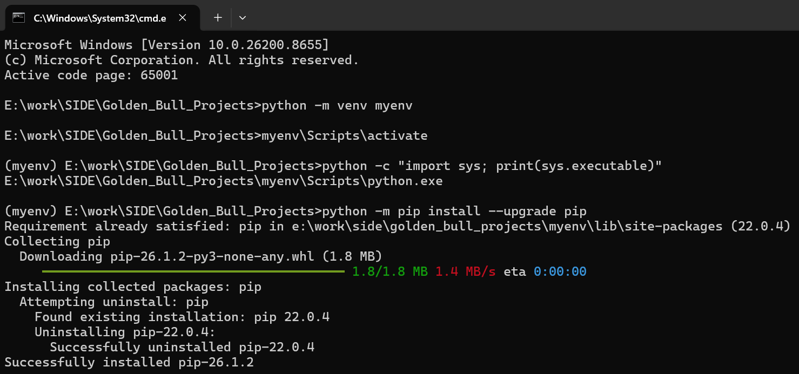
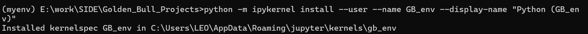

# GUI 虚拟环境搭建

## 创建 `myenv` 虚拟环境

建议把项目虚拟环境直接建在仓库根目录，名称统一为 `myenv`。这样做有两个好处：

- 环境跟项目放在一起，迁移和排查更直观
- 后续给 notebook 绑定 kernel、给 IDE 选解释器时都更方便

推荐 Python 版本使用 `3.10.x ~ 3.11.x`。

不强依赖 `conda` 或 `anaconda`，直接使用 Python 自带的 `venv` 即可。

在 git 仓库根目录里，可以直接点击路径输入框，输入 `cmd` 后回车，打开当前目录终端。

然后执行：

```bash
python -m venv myenv
```
* 注: 一定得命名为 `myenv`，否则后续任何处理都有可能报错。

创建完成后，激活虚拟环境：

```bash
myenv\Scripts\activate
```

如果需要删除已经创建好的 `myenv`，先确保相关终端、IDE、notebook kernel 都已经退出，再回到项目根目录执行：

```bash
rmdir /s /q myenv
```

删除后如需重建，再重新执行 `python -m venv myenv` 即可。

激活成功后，先确认当前 Python 指向项目里的 `myenv`：

```bash
python -c "import sys; print(sys.executable)"
```

如果输出路径落在 `..\Golden_Bull_Projects\myenv\` 下，说明环境已经切对了。

## 安装基础包并关联 notebook kernel

激活 `myenv` 之后，先安装项目依赖：

```bash
python -m pip install --upgrade pip
pip install -r requirements.txt
```

如果 `requirements.txt` 里没有包含 `ipykernel` / `notebook` / `jupyter`，再补装一次：

```bash
python -m pip install ipykernel notebook jupyter
```

然后把这个虚拟环境注册成 Jupyter kernel，统一命名为 `GB_env`：

```bash
python -m ipykernel install --user --name GB_env --display-name "Python (GB_env)"
```

这里：

- `--name` 是 kernel 的内部名称，建议保持简短且唯一
- `--display-name` 是 notebook 里看到的名字，可以写得更直观一些


注册完成后，可以用下面命令确认是否成功：

```bash
jupyter kernelspec list
```

如果后续想删掉旧的 kernel：

```bash
jupyter kernelspec uninstall GB_env
```

在 VS Code 或 Jupyter Notebook 中打开 `.ipynb` 后，选择 `Python (GB_env)` 即可把当前 notebook 绑定到这个项目环境。

如果你已经有现成的 `myenv`，不需要重新创建；只要激活到该环境，再执行 `ipykernel install` 这一步即可。

# 金牛奖GUI终端记录

## 记录说明

本文档记录对 `terminal.py` 与相关工具链的主要改动，方便后续回顾、继续开发与排查问题。

记录方式：

- 顶部“按日期更新”区：只记每天新增或调整的内容，后续续写时按新日期新增小节。
- 下方专题区：保留按功能整理的长期说明，方便集中回看某一块逻辑。

最后更新日期：2026-07-12

---

## 外部数据源清单

这里的“外部数据源”指各奖项每年评选所需的输入文件（不含代码、不含工作区产出文件）。不同奖项的外部数据源建议统一沉淀在各自的 `xxx步骤/原始数据集/<年份>/` 目录下。

### 私募金牛奖

统一建议放在：

- `GB_PriFund/原始数据集/<年份>/`

其中指数类数据当前代码口径使用的是：

- 沪深300指数 / 中证500指数 / 中证1000指数


#### 2024

目录：`GB_PriFund/原始数据集/2024/`

- 私募参评数据：`私募参评数据20240702.xlsx`
- 交易日历：`trade_days.xlsx`
- 结果反馈模板：`私募金牛奖计算结果反馈模板2024.xlsx`
- 指数收盘价：该年度目录下目前未见 `指数收盘价.xlsx`；如需跑“指数增强”相关逻辑，建议补齐沪深300/中证500/中证1000的指数收盘价文件

#### 2025

目录：`GB_PriFund/原始数据集/2025/`

- 私募参评数据：`私募参评数据20250630.xlsx`
  - 历史旧版：`旧的数据集/私募参评数据20250530.xlsx`
- 交易日历：`trade_days.xlsx`
- 指数收盘价：`指数收盘价.xlsx`（用于指数增强：超额收益、信息比率等）
- 指数回报（由收盘价加工得到，若代码改为直接读收盘价可不保留）：`指数周度回报.xlsx`、`指数月度回报.xlsx`、`指数周度年度收益率.xlsx`、`指数月度年度收益率.xlsx`
- 结果反馈模板：
  - `私募金牛奖计算结果反馈模板2025.xlsx`
  - 兼容旧命名：`私募金牛奖结果反馈模板2025.xlsx`

#### 2026

目录：`GB_PriFund/原始数据集/2026/`

- 私募参评数据：`私募参评数据20260601.xlsx`
- 交易日历：`trade_days.xlsx`
- 指数收盘价：`指数收盘价.xlsx`（用于指数增强：超额收益、信息比率等）
- 指数回报（由收盘价加工得到，若代码改为直接读收盘价可不保留）：`指数周度回报.xlsx`、`指数月度回报.xlsx`、`指数周度年度收益率.xlsx`、`指数月度年度收益率.xlsx`
- 结果反馈模板：`私募金牛奖结果反馈模板2026.xlsx`
- 可选补充/核验数据（只在人工补录、核验、对账时使用，不是每年必跑依赖）：
  - `超量子补充数据.xlsx`、`超量子补充数据update.xlsx`
  - `超量子基金周度净值切片_20251231.xlsx`
  - `华鑫MOM37.xlsx`
  - `私募金牛奖计算数据20260624.xlsx`

### 公募金牛奖

- 待补充

### 银行理财金牛奖

- 待补充

### 分析师金牛奖

- 待补充

### 券商资管金牛奖

统一建议放在：

- `GB_BrokerAM/原始数据集/<年份>/`

其中机构原始申报材料当前主链主要使用的是各家机构上传的：

- 基础信息
- 产品净值
- 历任基金经理信息
- 规模
- 拆分
- 分红
- 补充资料 / 定性材料（如有）

除机构申报材料外，券商资管当前还依赖以下额外外部数据源：

- 市场指数 3 项：
  - `riskfree_rate.xlsx`：无风险收益率
  - `mkt_close_filled.xlsx`：沪深300收盘价
  - `mkt_close2_filled.xlsx`：中证全债收盘价
- 管理人奖 / 公司奖相关外部数据：
  - `营业收入.xlsx`
  - `资产管理业务收入.xlsx`
- 交易日历：
  - 当前主链默认不再依赖单独的 `trade_days.xlsx`，而是由 `exchange_calendars` 动态生成上交所交易日历
  - 若后续需要固化历史口径或脱离 `exchange_calendars` 运行，可额外准备 `trade_days.xlsx` 作为兼容输入

这些额外数据在当前代码里的主要消费位置是：

- 市场指数：`step_0_前期准备/0_市场指数入库/1_市场指数提取与入库.ipynb` 负责提取、处理、入库；下游 `step_3 ~ step_5` 再消费 `riskfree_rate / mkt_close_filled / mkt_close2_filled`
- 管理人奖 / 公司奖：`step_5_计算/2_排名.py` 在 `yr == 2024` 时会读取 `营业收入.xlsx` 与 `资产管理业务收入.xlsx`
- 交易日历：`step_4_缺失填充/1_缺失判定与填充.py` 与 `step_5_计算/1_计算.py` 当前均通过 `exchange_calendars` 直接生成

## 按日期更新

### 2026-07-12

- 工作区顶部视图补齐为“主界面 / 流水线 / 数据文件 / 规则/所给数据集 / 计算结果”，并改为按需渲染：只有切换到对应页时才初始化面板，刷新时也仅重建当前视图，减少挂载工作区时的无效 UI 开销。
- “数据文件”页内部切换扩展为“数据文件 / 已处理 / 重要文件 / 数据库”。“已处理”会从挂载工作区名称解析年份，定位到奖项目录的 `已处理/{YR}`；“重要文件”定位到当前工作区 `重要文件`。两个视图均递归展示子文件夹、相对路径和项目数，并保留独立滚动位置。
- “计算结果”不再假定固定步骤号。当前兼容 `step_n_计算/计算结果`、旧式 `step_n 计算/计算结果`、`重要文件/结果` 和 `重要文件/计算结果`；结果根目录下如 `0712` 这类子文件夹直接用真实目录名分组，不再统一归到“其他”。
- 数据库看板的路径解析从写死 `DB_PRIVATE.duckdb` 改为扫描 `GB_*/数据库/{YR}/*.duckdb`；侧边栏的入库/删库路径提示也不再假定固定文件名。数据库界面最终保留原有轻量方式：列出常用表，提供“查行数 / 前20行”，未保留曾试做过但存在卡顿的独立结构化查询组件。
- 工作区 GUI 状态新增了数据文件内部视图的持久化兼容，`output / processed / important / database` 均可恢复；输出、已处理、重要文件和数据库分别保留各自的滚动位置。

### 2026-07-06

- 树状文件编辑器的保存后联动已改成完整串行链路：`gui/file_tree_editor.py` 现在会在写回 `文件结构.xlsx` 后，优先执行**工作区根目录**的 `update_all_code.py`，再执行 `step_0_前期准备/运行此文件.py`；两个脚本都跑完后，才统一刷新工作区并弹最终提示框。这样中间不会先刷新一遍旧状态，失败时弹窗也会附带最近输出摘要，便于直接定位问题。
- `file_tree_editor.py` 同时新增了 `只运行一次` 配置列与下拉框（`是/否`）。这个配置只用于主界面的软提示，不做硬拦截；如果某个脚本历史上已经成功运行过，步骤区会提示“通常可跳过”，但仍允许继续勾选和运行。
- 工作区步骤区的 UI 已收成单行：`选中框 - 名称 - 成功次数计数块 - 打开按钮`。左侧控制列同步收窄，计数块按历史成功次数着色，其中 `只运行一次=是` 且成功次数大于 1 时显示橙色，其余脚本按成功次数分为绿色 / 黄色，不再出现红色提示块。
- notebook 调度日志补做了一轮收口：`gb_runtime_patch/step_process_entry.py` 现在会把 notebook 单元格输出按顺序平铺到日志里，并去掉 ANSI 颜色控制符；当 notebook 执行失败时，也不再额外叠加一坨重复 traceback。与此同时，运行路径解析会优先读取 `GB_NOTEBOOK_PATH` / `GB_SCRIPT_PATH`，减少 `.ipynb` 在调度模式下拿不到 `__file__` 的问题。
- 调度主链再补一层运行顺序防护：`terminal.py` 现在会在批量运行前检查所选步骤是否存在重复 `运行顺序`；若存在冲突，本次调度会直接取消，并在底部日志列出冲突序号和对应脚本，避免同一序号下的步骤被静默跳过或顺序不确定。
- 主步骤链执行顺序改为显式排序：`run_next_step()` 不再直接依赖 manifest / Excel 原始行顺序，而是统一通过 `get_ordered_manifest_steps()` 按 `运行顺序`、显示名自然序排序后执行，让 UI 展示顺序与真实调度顺序更一致。
- Windows 异步 PID 存活判断改用 `tasklist` 兜底：`is_pid_running()` 在 Windows 下不再只依赖 `os.kill(pid, 0)`，减少异步 PID 文件清理和暂停按钮状态的误判概率。
- 进程状态管理增加轻量注册表：每次拉起子进程都会生成 `run_id` 并登记到 `process_registry`，结束或异常时注销；原 `current_process` 仍保留兼容现有暂停按钮和 UI 状态，后续如需做多进程接管、恢复或更细粒度展示，可直接基于这层注册表继续扩展。
- 根 README 这里后续只保留通用 GUI / terminal / 运行框架更新；奖项业务相关改动分别沉淀到 `GB_PriFund/README.md` 与 `GB_BrokerAM/README.md`。

### 2026-07-05

- notebook / terminal 混合编排正式打通：`gb_runtime_patch/step_process_entry.py` 已支持 `.py` 走 `runpy`、`.ipynb` 走 `nbclient`；`terminal.py` 现会把 `.ipynb` 识别为可执行步骤并透传 `GB_NOTEBOOK_PATH`、`GB_SCRIPT_PATH` 及同一轮 attempt/session 上下文。对应 notebook 模板也已收口为“保留原有 `from userlib.tools import *` 导入结构，只在后续 cell 增量补运行路径适配”，避免为接入 terminal 而改业务层导入风格。
- `userlib/tools.py` 的 notebook 输出兼容补稳：`display_pub.publish()` 的包装层已改为按底层真实签名选择性透传 `metadata/source/transient/update`，修复部分 notebook 内核下 `ZMQDisplayPublisher.publish() got an unexpected keyword argument 'source'`，避免写库或展示阶段被显示层包装器打断。
- 树状文件编辑器的“运行顺序”冲突处理已收口为全局自动插入：占用提示重新按全局顺序统计；当用户把某个代码文件改到一个已被占用的运行顺序时，系统不再弹确认框，而是自动将该文件插入到该序号，并把全局所有 `>= 该序号` 的后续代码顺延一位。对应 helper 也已改名为更准确的 `_auto_insert_run_order_if_needed()`。

### 2026-07-03

- notebook 手动时间记录链路补通：`userlib/tools.py` 中 `insert_bookmark()` 已修复 `tag_=0` 时“写入开始日志”和“返回给 notebook 的上下文”不一致的问题；现在 `.ipynb` 使用 `start = insert_bookmark(file, 0, rel)` 与 `insert_bookmark(file, 1, rel, start)` 时，`start/end` 会稳定复用同一组 `session_id/run_id`，不再在流水线里被拆成一条成功、一条失败的两条未归档记录。
- notebook 记录已正式进入流水线页：`terminal.py` / `workspace_ui.py` / `gui/pipeline_gantt.py` 这一轮联动后，带顺序号的 `.ipynb` 已可出现在步骤脚本列表中，界面标记为“仅打开”且不可勾选运行；同时手动写入 `时间记录.log` 的 notebook 记录，也能在 `流水线` 页的“未归档”视图中直接看到。
- 流水线尝试切换补调：顶部“已归档 / 未归档”已从占位较大的 tab 收敛为切换按钮；未归档列表与已归档列表不再混放，切换当前范围或切换尝试时，也会同步重置流水线滚动位置，减少旧滚动偏移把内容顶出视区的问题。
- notebook 独立日志已落地：除全局 `参评信息/时间记录.log` 外，`insert_bookmark()` 现在还会为 notebook 手动记录额外生成工作区级独立日志，路径落在 `logs/<奖项目录>/<workspace_id>/runtime/` 下，例如 `run_xxx_2_数据入库.ipynb.log`；该日志已包含该次 notebook 运行的 `start/end`、`run_id/session_id` 与结构化 `GB_TIMELINE` 记录，便于按文件单独排查。
- 流水线未归档视图的打开入口已补一层兜底：当某条未归档记录暂时找不到对应归档日志时，当前实现会优先尝试定位该条记录的独立 `.log`；若独立日志尚未生成，则再回落到全局 `时间记录.log`，避免点击后完全无响应。
- notebook 独立日志语义补强：`insert_bookmark()` 生成的工作区级独立日志现在会补写头部摘要、文件类型、工作区根目录、父任务、开始/结束时间与耗时等可读字段；因此即便暂时还没有 notebook 单元格原始输出，也能先从独立 `.log` 里直接看清这次手动记录对应的是哪个 `.ipynb`、归属哪条父链以及完整起止区间。
- 未归档短流水线的紧凑缩放补一轮：`gui/pipeline_gantt.py` 现对“少量、短时长”的记录单独走紧凑刻度；像 notebook 手动记录这类未归档短尝试，不再硬套原先偏长流程的秒级像素比，从而减少上半部泳道图被明显空白撑开的情况；单条极短记录则继续直接折叠泳道图。
- 这轮已经试过、后续默认不要再重复投入的方向也一并记下：
  - 通过 `notebook.notebookapp` / `jupyter_server.serverapp` 反查运行中 server/session，再自动推 notebook 文件名：在当前 VS Code notebook 环境里不稳定，曾出现黄色波浪、拿不到 server、拿不到 session，最终没有作为主方案保留。
  - 依赖 `tools.py` 内部 `globals().get("__vsc_ipynb_file__")` 自动取 notebook 文件名：理论上接近可用，但模块内 `globals()` 与 notebook 单元格全局并不等价，实际不如直接传 `file` 稳定，因此当前不再继续沿这个方向堆 patch。
  - 未归档与已归档混放在同一个下拉里：虽然技术上能做，但体验混乱，已经明确收口为“范围切换 + 当前范围下拉”；后续除非整体重做流水线交互，否则不再回退到混放方案。
  - 顶部使用 `tab` 承载“已归档 / 未归档”切换：已经试过，确认过于占位，现已收口为切换按钮；后续不再回到 tab 方案。
  - 仅靠“压低泳道图最小高度”解决未归档大空白：已经试过一轮，效果不足，说明空白不只是泳道图区高度问题；后续应优先查外层布局/滚动恢复，不再把时间耗在继续微调 `body_height` 上。
  - 把 notebook 独立日志理解为“等同真实脚本 stdout/stderr 输出”：这一路已经验证不成立，当前独立 `.log` 本质上仍是时间记录侧的结构化回放；后续若要补“真正输出日志”，应单开一套 notebook 输出采集方案，而不是继续往现有 `GB_TIMELINE` 文本里硬塞。
- 当前仍保留两个待继续收口的问题：
  - notebook 真实输出尚未进入独立日志：当前独立 `.log` 已能看清文件、父链、起止时间与耗时，但本质上仍属于 `insert_bookmark()` 时间线摘要；后续若要进一步贴近用户理解中的“notebook 日志”，仍需要单开一套 notebook 单元格输出 / 异常文本采集方案。
  - 未归档短流水线虽已明显收紧，但若后续仍出现大空白，应优先排查外层布局容器、滚动恢复链路或其它非时间轴缩放因素，而不是继续只改 `body_height` 常量。

### 2026-07-02

- 工作区 `文件结构.xlsx` 编辑链路集中修正：`gui/file_tree_editor.py` 的保存逻辑现以 `index` 作为物理行锚点，已有行按原行更新，删除行按 `index` 精确移除，新建/跨目录移动的文件行统一分配全新 `index` 并追加到表尾，避免因重排或复用旧 `index` 导致 Excel 物理顺序错乱。
- `index` 兼容修复补上：读取 `文件结构.xlsx` 时，若缺少 `index` 列，或存在空白 / 重复 `index`，系统现只补 `index` 字段并立即原子写回原文件，不再连带改动其他业务列，避免后续再基于脏表做 concat/重建映射。
- 树状视图建树逻辑修正：文件夹树的内部唯一键不再只看“目录名路径”，而是改为携带 `步骤 + 路径` 的组合键；因此现在允许不同 step 下出现同名顶层文件夹、同名子文件夹，而不会在左侧树中被错误合并。
- 步骤占用提示与重复校验修复：由于顶层文件夹内部 key 已从字符串变为元组，编号占用提示、步骤重复提示一度因 `join(tuple)` 崩溃；现已统一改为先转成用户可读文本再展示，点击文件夹时不会再触发 `TypeError: expected str instance, tuple found`。
- 说明/代码保存位置显示收敛：说明文件的保存路径显示改为严格按实际值渲染，不再错误继承“代码子文件夹”；同时右侧详情表单回填以实际 Excel 内容为准，避免打开说明文件时界面仍默认显示“更新代码”。
- 工作区模板复制链路排查补记：问题确认与 `scripts/create_award_workspace_template.py` 的模板后处理有关，后续维护时需特别避免在复制默认 `文件结构.xlsx` 后，再批量覆盖 `代码子文件夹`、保存名等业务字段；这类脚本只应修工作区名锚点，不应重写文件结构语义。
- Tkinter / CustomTkinter 关闭清理补强：`terminal.py`、`gui/file_structure_editor.py`、`gui/config_editor.py` 均补上 `after(...)` 回调跟踪与关闭时取消，主窗口销毁顺序也改为先 `withdraw/quit` 再 `destroy`，用于减少关闭窗口时的 `invalid command name "...update" / "...check_dpi_scaling"` 报错。

### 2026-06-30

- 修复运行日志“输出两遍”：处理 Windows 的 CRLF（`\r\n`）被误当成覆盖式 `\r` 导致重复落盘的问题（影响：异步桥接日志/主日志汇总）
- 运行日志目录统一到仓库根目录 `logs/`（不再写到 `gui/logs/`）
- 删除工作区脚本补稳：脚本从任意工作目录启动时，仍能正确导入 `award_config`（避免 `ModuleNotFoundError`）
- 步骤显示补稳：顺序代码列表按运行顺序排序；当目录同时存在“下划线版/空格版”时，以“目标脚本是否存在”决定实际连线，避免误判 `[缺失]`
- DuckDB 写入补稳：写库前将 object 列中的 `numpy.ndarray/tuple` 归一化为 `list`，降低后续读取时出现 `array(...)` 字符串导致解析冲突的概率

### 2026-06-29

- 工作区步骤识别补稳：`terminal.py` 与 `workspace_ui.py` 中“可执行步骤”判定不再强依赖 Excel 把 `运行顺序` 读成数值类型；现已兼容数字字符串（如 `"1"`、`"11"`、`"1.0"`），避免新增或复制行后仅因单元格类型变成文本，导致某个 step 从步骤列表中消失。
- 步骤目录命名统一到下划线风格并保留旧目录兼容：`_step_folder()` 现优先生成 `step_{步骤}_{工作区文件夹}`，同时在磁盘存在旧目录 `step_{步骤} {工作区文件夹}` 时自动回退，方便逐步从空格版目录过渡到下划线版而不影响既有工作区。
- 文件结构编辑器默认入口切换为树状视图：terminal 现默认打开 `file_tree_editor.py`；若用户点击“表格视图”，再打开 `file_structure_editor.py`。同时树状视图新增“编辑工作区名”，可直接修改 `文件结构.xlsx` 中的工作区名锚定值。
- 表格视图兼容稀疏工作区名：`file_structure_editor.py` 现支持“工作区名”只在首行填写、后续行留空的稀疏表结构；显示时会沿用上一条非空工作区名，保存时若识别为稀疏模式，则继续保持原有稀疏写法，不再出现“只显示一行”的问题。
- 树状视图补强：新增“打开xlsx”入口；左侧支持直接新建 `步骤文件夹 / 输出文件夹 / 普通文件夹 / 文件`；步骤文件夹与输出文件夹改为先在当前位置落默认节点，再在右侧编辑名称和属性；左侧树支持 `Backspace` 删除；树区宽度与名称列宽度适度放大；工具条重新整理为单行显示。
- 树状视图中的说明/代码绑定从“手填其他列”改为“说明选代码”：在说明文件右侧可直接多选同 step 的代码文件建立绑定；代码侧只读显示自己绑定到哪些说明。保存时系统会按说明行自上而下自动生成简短绑定号（如 `AA/AB/AC...`）并写回 `其他` 列；terminal 侧说明挂接逻辑也同步支持代码行持有多个绑定号。
- 树状视图的输出项“对应代码”改为下拉选择：不再要求手动输入，现从同 step 的代码文件自动生成可选列表；新建输出文件夹时也不再先要求填写“对应代码”，创建后可在右侧直接选择。
- 文件结构编辑器增加保存名冲突校验：当修改“保存在资料中的名称”时，若与当前 `文件结构.xlsx` 中任一已存在的保存名重复，会阻止提交并明确提示撞名的目标行与所在目录，避免后续 `资料/代码` 中的源文件互相覆盖。
- 私募可视化脚本补缺列容错：`GB_PriFund/2026私募_260625_0/step_5_可视化/1_可视化.py` 中对指数增强拟合净值列的访问改为先检查列是否存在；若相关列缺失，则回退到安全默认值，不再因为个别机构没有某条拟合净值列而直接报错。
- `reset_all_code.py` 修复“正常代码被默认模板反向覆盖”的严重问题：`GB_PriFund/2026私募_260629_1/reset_all_code.py` 中 `rev_copy_file()` 的返回值语义已修正，现仅在源文件不存在时才回退复制 `default_code.py/readme.docx`；此前“复制成功却返回 0、外层又用 `if not ...` 判定”的错误逻辑，可能导致真实代码刚复制过去就又被默认模板覆盖。

### 2026-06-26

- 终端窗口默认最大化：主程序启动后会立即将主窗口置为最大化（不影响后续手动缩放/还原）。
- 控制台日志自动跟随回底：底部日志区在 3 秒无人操作时会自动回到底部，避免运行时用户被历史输出“卡住”看不到最新日志；跟随间隔抽为常量 `LOG_AUTO_FOLLOW_IDLE_MS = 3000`，便于后续统一调整。
- 配置编辑窗口默认最大化：从侧边栏“配置文件”入口打开的 CFG 编辑窗口，打开即最大化，保留置顶打开体验，但不再以对话框模式限制窗口能力（可最大化/还原/调整大小）。

### 2026-06-23

- 左侧工作区配置台新增 `初始化` 按钮：位置放在“资料浏览”上方，样式为黑底白字；点击前要求先选定奖项与年份，随后会在对应奖项根目录查找并执行 `initialize.py`。当前只认标准文件名 `initialize.py`，不再兼容误拼写的 `initailize.py`。
- 初始化链路补齐年份透传：从左侧 `初始化 -> terminal 内继续运行后续脚本` 这条链路出发时，会把当前所选年份通过环境变量传入子进程；`userlib/tools.py` 中的 `custom_input_dialog()` 会优先用这份年份自动填充“评奖年份”类输入项，尽量避免再手动输入；若不是从这条链路进入，仍保持原先手动输入年份的行为。
- 初始化弹窗信息收口：初始化成功时仅提示奖项、年份与脚本名等关键信息；初始化失败时才额外附带少量错误摘要，不再把整段控制台输出原样塞进弹窗。
- 初始化完成后自动刷新左侧列表：`initialize.py` 成功执行后，会立即刷新左侧年份/工作区列表，方便直接看到初始化新生成或新变化的工作区内容。
- 私募项目总览文档已同步补写：`GB_PriFund/2026私募_260621_0/step_0 前期准备/私募步骤总览.docx` 中已补入一版“整个私募项目”的简要总览，覆盖准备、清洗、计算、可视化、汇总等主链步骤，以及常用目录与推荐运行方式说明。
- 异步进程控制本轮最终状态回退到原始版：此前曾尝试补“真实异步 Python 子进程 PID 追踪”以及“关闭黑窗时联动杀真实子进程”的增强方案，但在多轮来回验证后，当前代码已回退为原始语义，即不再额外追踪真实异步子进程，也不再启用 `watch-parent-pid` / `job object kill-on-close` 这类强联动逻辑，先以最初版本继续观察。

### 2026-06-22

- 私募可视化输出口径补齐：`GB_PriFund/2026私募_260621_0/step_5 可视化/1_可视化.py` 中将策略代号 `fofmom` 的输出路径/图标题/文件名统一改为展示名 `组合基金`，避免生成 `.../fofmom/...` 目录；同时右侧指标板中的“排名”改为 `排名: rank/total`（分母为该组别进入排名的机构/经理总数），用于快速判断相对位置。
- 私募信息汇总补“分类总数”列：`GB_PriFund/2026私募_260621_0/step_6 信息汇总/1_信息汇总.py` 在 `计算结果展示` 表中新增 `分类总数`（放在 `排名` 右侧），口径为按 `频率 + 分类` 分组后的去重样本数（公司口径按机构编号聚合，经理口径按机构经理唯一键聚合）。
- 初始化脚本暂时关闭自动入库触发：`_必备代码/_基础代码/run_this.py` 中“若未检测到 `../../数据库/{yr}` 则写入 `ingestion_request.json` 并调用 `data_ingestion.py`”的整段逻辑已整体注释，避免在当前阶段误触发入库模式。
- Git 跟踪范围继续收口：根仓库 `.gitignore` 规则已从“忽略全部 Markdown”调整为仅忽略特定本地文档（如 `DB_README.md`、`debug-*.md`），并停止跟踪样例数据文件 `userlib/test.csv`，避免把本地临时数据带入版本库。

### 2026-06-21 19:02:09

- 删除工作区链路补全日志清理：`delete_workspace.py` 现会在删除工作区目录前，先根据 `.gb_workspace.json` 中的 `award_dir_name + workspace_id` 定位对应 `logs/奖项目录/workspace_id/`，并同步删除该工作区的运行日志、尝试归档与异步日志；GUI 删除确认文案也已明确提示“会一并删除该工作区在 `logs` 下的所有日志与尝试归档”，避免日志目录长期积累为孤儿目录。
- 流水线页自动刷新策略收紧：运行中只在主链仍存活时按节流频率刷新；主链结束、仅剩异步运行时不再无脑重绘；尝试真正结束后只保留一次最终 `auto_scale` 刷新。同时，流水线重绘前后会记住并恢复滚动位置，不再每次刷新都跳回最上方。
- 主日志与异步日志的 `tqdm/\r` 进度条都继续收口：主步骤日志中连续进度输出现只保留最后一条；异步桥接日志也新增同类整形，对反复覆盖同一行的进度条按“最后状态”落盘，避免日志中堆满 `0% -> 50% -> 100%` 的重复刷新行。
- `open_file()` / 异步日志链路这轮最终落地为“正式改本体”的方案：最初为了不碰 `userlib/tools.py`，先后尝试了主程序环境变量注入、`sitecustomize.py` 运行时 patch、`step_process_entry.py` 包装入口与 trace 埋点等方案；运行证据证明这些 shim 确实加载了，但目标脚本实际调用异步时仍会命中旧函数引用，运行时 monkey patch 链不够稳定，继续堆补丁已不划算。
- 因此最终直接修改 `userlib/tools.py` 的 Windows 异步启动分支：`open_python_async()` 现优先改走 `gb_runtime_patch/async_console_bridge.py`，由桥接脚本直接拉起目标 `.py`，实时读取原始 `stdout/stderr` 并同步写黑窗与 `.log`；仅当桥接脚本缺失时，才回退到原有 `Start-Transcript` 链路，借此尽量规避“改完后异步脚本打不开”的回归风险。
- 新方案已通过最小链路验证：像 `step_0_5 初步清洗可视化/可视化.py` 这类异步脚本现在已能稳定生成正文完整的新日志，日志头不再是 `Start-Transcript`，中文也不再出现双字重影；黑窗“打开后很快关闭”在成功场景下属于原有语义保留，即“成功自动关、失败才停留”。

### 2026-06-21 17:25:09

- 修复流水线尝试状态偶发卡在“进行中”的问题。排查发现，部分尝试在 `summary.json` 与 `run/index.json` 中会停留在 `status=running`、`is_final=false`，但实际上对应归档已无运行中条目，界面顶部同时会显示“主进程: 已结束 | 异步: 已结束”，从而形成明显矛盾。现已在 `pipeline_gantt.py` 增加陈旧运行态归档的自动矫正：只要读取到某次尝试 `status=running` 且 `running_entry_total=0`，就会根据已有归档信息自动推断最终状态并回写到 `summary/index`。推断规则为：若备注含“用户手动终止”则改为 `cancelled`，若存在失败条目或错误摘要则改为 `failed`，否则改为 `success`；同时补齐 `status_label`、`ended_at` 与 `is_final=true`。
- 这项修复不仅纠正当前界面显示，也会把已有历史归档从“卡死 running”自愈回来，避免后续再次打开同一尝试时继续错误显示“进行中”，并连带影响 auto-scale 判断。

### 2026-06-21 17:18:10

- 在不改动 `userlib/tools.py` 的前提下，对异步脚本输出再补一层主程序侧兜底：`terminal.py` 的顺序代码启动环境新增 `PYTHONIOENCODING=utf-8` 与 `PYTHONUTF8=1`，并保留已有 `PYTHONUNBUFFERED=1`。由于异步 `open_file()` 是从顺序代码进程里再派生出来的，因此后续异步子脚本会继承这组环境变量，目的是尽量缓解当前出现的两类问题：部分 step_6 异步日志只有 transcript 头没有正文，以及已有正文的异步日志存在重影/乱码。
- 本次仅修改主程序侧环境传递，不碰 `tools` 的启动包装逻辑；是否完全消除 `1_信息汇总 / 2_净值汇总` 正文缺失，还需要下一轮实际运行后再确认。

### 2026-06-21 17:06:46

- 调整“当前运行步骤”自动跟随频率：此前为了保证运行中的步骤始终处于可视区内，曾在呼吸高亮的每次闪烁周期都触发一次滚动检查，体感过于频繁。现已收窄为仅在顺序步骤切换到下一个步骤时滚动一次，避免用户中途查看附近步骤时视角被反复抢走。
- 修复异步 Python 黑窗日志只有头部、没有脚本输出的问题：排查发现原实现仅依赖 PowerShell `Start-Transcript` 记录异步脚本日志，而该机制对原生 `python.exe` 的标准输出/标准错误捕获并不稳定，因此会出现日志里只有 transcript 头、没有实际 `print` 输出的情况。现已改为在 `userlib/tools.py` 的 Windows 异步启动包装里显式创建 `ProcessStartInfo`，重定向并实时采集 `stdout/stderr`，同时继续在黑窗中显示并同步写入同一 `.log` 文件。该修复只影响后续新启动的异步脚本，旧日志不会回补历史输出。

### 2026-06-21 16:55:51

- 调整“当前运行步骤”滚动跟随策略：此前启动某个顺序步骤时只在开始瞬间执行一次滚动，且默认把当前项顶到较靠上的位置；现改为在运行期间随呼吸高亮周期持续检查当前步骤是否仍位于可视区内。若当前项已在视角内则不动；若接近底部最后几项则直接滚到底；其余情况尽量把当前项保留在可视区偏上、近似“第二个位置”，避免每次都顶到最上方。
- 调整泳道点击打开代码的方式：`workspace_ui.py` 中对 `.py/.md/.txt/.json/.log/.csv` 等代码或文本文件，现优先尝试走 `trae --reuse-window --goto`，失败后再退回 `code --reuse-window --goto`，最后才使用系统默认打开。这样做的目的是尽量避免点击泳道色块时再触发系统文件关联链带出的 `ProcessMonitor constructor` / `punycode` / `Lifecycle#kill()` 这类 Trae/Node 退出警告日志。

### 2026-06-21 16:27:43

- 修复“重开终端后所选步骤异常”的一条关键保存链问题：排查发现工作区 `参评信息/gui_state.json` 中的 `selected_step_orders` 会被写成空数组，导致重新挂载工作区后，参考勾选状态恢复失真，进而影响“所选运行”的实际执行范围。
- 根因在于 `workspace_ui.py` 刷新 `render_tab_content()` 时会先销毁步骤勾选控件并清空 `step_vars`，而此前延迟中的 `gui_state` 写盘任务可能恰好在这段空窗期触发，把空勾选错误保存回 `gui_state.json`。现已改为：在整段渲染期间统一挂起 `gui_state` 写盘；销毁控件前先把当前勾选同步缓存到 `saved_step_selection_orders`；开始新一轮运行时也同步把本轮勾选写入缓存；真正写盘时若当前处于渲染冻结期，则优先使用缓存勾选而不是临时空的 `step_vars`。
- 这样处理后，工作区重开后不应再把“所选步骤”误恢复为空，也不会在界面刷新过程中把勾选状态覆盖丢失。

### 2026-06-21 16:19:14

- 修复 `机构筛选.py` 的“添加机构”分支：此前 `custom_dialog()` 返回值被直接复用为后续分支判断，导致已有 `机构信息.txt` 时点击“添加”，实际走到了“只读取旧 txt、不再收集新输入”的路径，因此看起来像“直接跳过了所有新增”。现已改为显式区分“首次筛选 / 更新 / 添加”三种模式。
- `添加` 模式现改为：先读取已有 `参评信息/机构信息.txt` 中的机构编号，再弹出批量输入框继续追加新的机构索引/名称，最后统一去重写回；`更新` 模式仍按新输入重建名单；若后续从 `资料/代码/更新代码/select_institution.py` 再同步工作区，也已同步带上相同修复，避免旧逻辑回流。

### 2026-06-21 15:42:11

- 流水线页点击打开路径补稳：`workspace_ui.py` 的 `open_path()` 现在会先将传入路径统一做 `abspath + normpath` 后再 `os.startfile()`，避免在流水线页点击泳道色块或其它打开入口时，带 `..` 的路径字符串直接送进系统导致“无法打开路径”。
- 流水线摘要区改为展示全部记录：原先 `pipeline_gantt.py` 中“最近记录摘要”只显示倒序最近 8 条，现已改为按当前尝试的完整记录倒序全部展示，并将标题同步改为 `本次全部记录 (N 条)`，不再截断。
- 流水线点击行为继续细分：上方泳道图色块继续打开对应代码文件；下方 `本次全部记录` 中每一条记录改为优先打开该条记录对应的归档日志文件，形成“上方看代码、下方看日志”的固定交互。
- 兼容旧相对路径记录：针对历史尝试中异步条目的 `rel_path` 可能写成 `..\\..\\..\\step_xxx\\...` 的情况，流水线页在打开上方色块前会先结合 `parent_rel` 回推真实代码路径，避免旧记录点击后飘到工作区外。
- 旧异步记录路径兼容再补强：对于会被解析成 `E:\\work\\SIDE\\step_xxx\\...` 这类明显脱离工作区根目录的旧记录，现新增“剥离前置 `..` 后重新拼回 `AWARD_ROOT/工作区`”的兜底解析，确保像 `step_6 信息汇总/1_信息汇总.py` 这类代码仍能从流水线色块正确打开。

### 2026-06-21 15:09:37

- 工作区参考态持久化第一版落地：为每个工作区新增 `参评信息/gui_state.json`，用于保存 GUI 参考状态；目标是让界面本身尽量无状态，重新打开同一工作区时可以恢复上次参考视图。
- `gui_state.json` 当前保存内容包括：上次勾选的顺序步骤、各顺序步骤状态、主计时器累计秒数、失败态标记、当前主视图页签、左侧 `步骤代码 / 代码文件夹` 选择、右侧 `数据文件 / 数据库` 视图、流水线页当前选中的尝试、错误定位到的文件夹与文件。
- 恢复策略补充：工作区挂载时会先读取 `gui_state.json` 再构建界面；步骤状态只恢复当前 manifest 中仍合法的 `order`；若上次关闭前某步骤处于 `running`，这次恢复时会自动清洗为 `pending`，避免 GUI 重开后出现假的“正在运行”。
- 保存策略补充：新增延迟合并写盘逻辑 `schedule_gui_state_save()`，避免勾选、切页、状态更新时频繁同步写盘；默认采用短延迟 debounce，在高频交互下只保留最后一次快照。
- 运行链关键节点已接入保存：新一轮运行重置、步骤成功/失败、错误定位更新、主计时开始/停止、尝试结束、关闭工作区前清理等场景都会刷新 `gui_state.json`，保证工作区参考态随运行过程同步更新。
- UI 交互侧已接入保存：切换 `主界面 / 流水线 / 数据文件`、切换左侧 `步骤代码 / 代码文件夹`、切换右侧 `数据文件 / 数据库`、修改步骤勾选、在流水线页切换尝试，都会同步保存到 `gui_state.json`。
- 当前实现边界：`gui_state.json` 只保存“当前参考态”，不替代已有的 `summary.json`、`records_summary.json`、`timeline.log` 等尝试归档；新开一次 `一键运行(所选)` 后，参考态会按新的运行结果继续覆盖更新。
- `编辑机构名单 (txt)` 入口位置调整：从左侧工作区配置台移出，改为放到每个已挂载工作区自己的 `代码执行区` 控制列中，避免全局入口与当前标签页工作区错位。
- `编辑机构名单 (txt)` 可用性约束补充：按钮现在按当前工作区 `参评信息/机构信息.txt` 是否存在决定是否可点；若文件缺失则直接禁用，并在按钮下方提示缺少 `机构信息.txt`，避免点了才发现没有对应配置文件。

### 2026-06-20 09:38:44

- `open_file()` / 异步启动链路继续修正：Windows 下 `.py` 统一改走工作区虚拟环境 `python.exe` + PowerShell 包装层；去掉 transcript 分支中的 `2>&1`，避免 `tqdm` 等 `stderr` 输出被 PowerShell 误识别为 `NativeCommandError`；黑窗保留“成功自动关、失败保留”的可见语义。
- 主链失败时的异步保留现场：主链失败后不再立刻强杀 async 子进程；失败现场继续保留，避免用户体感成“黑窗没打开/一闪而过”；同时补充了错误高亮与失败链日志说明。
- `step_3` 文件锁容错补强：为年期判定前的目录删除链路补重试，避免在 `check_with_retry(record_path)` 之前就因为 `shutil.rmtree()` 遇到占用直接中断。
- 主界面顶层结构调整：主区域正式拆成 `主界面 / 流水线 / 数据文件` 三个顶层页签；原右侧“输出文件”看板已整体迁到新的 `数据文件` tab 中，`主界面` 保留代码执行区、说明文档区和下方控制台。
- 主界面布局继续紧凑化：代码执行区与说明区重新分配宽度，说明区收窄；运行计时改到步骤区右上角；冗余说明文案删除；`全选 / 全不选 / 一键运行(所选) / 暂停` 压缩为两行；`暂停` 按钮改为自适应宽度，避免被挤成不可见红块。
- 控制台空间优先级上调：控制台默认高度继续提升，并把主界面上下布局改为“底部控制台优先吃剩余空间”；同时压缩顶部与中间留白、隐藏空进度行、让日志框吃满控制台主体；后续又进一步把上半区从“会主动抢高度”改为“只拿自己需要的高度”，避免出现大片空白把控制台顶小。
- `步骤脚本` 区可压缩：步骤区内部改为固定矮窗 + 滚动展示，不再默认撑高；当前运行项会自动滚到可视位置，代码光标会随着正在运行的文件走。
- 左侧挂载流程改造：工作区配置台现改为 `先选奖项 -> 再选年份 -> 再选工作区`；年份固定显示 `今年 -> 2025 -> 2024 ...`，不依赖当前是否已有工作区；年份判断继续以原始工作区文件夹名前四位为准，工作区展示与排序则按重命名后的显示名字母顺序。
- 工作区日志入口修正：`打开完整日志目录` 现改为直接打开当前工作区自己的日志目录 `logs/奖项目录/workspace_id/`，不再跳到总 `logs` 根目录。
- 工作区顶部横向步骤条落地：在工作区标题下方、内层 `主界面 / 流水线 / 数据文件` tab 上方新增独立横向步骤条；每个工作区单独一条，只在真正开始运行主步骤链后显示；颜色联动 `pending / running / success / error / skip / missing`；显示顺序改为严格按 `order` 从小到大，标签按 `s0 / s1 / s2_1 / s2_2` 规则生成。
- 错误定位交互增强：主链失败时左侧自动切到 `代码文件夹` 页，高亮出错文件夹与文件；`代码文件夹` 的滚动条会自动移动到错误文件所在位置，而不是把错误文件夹直接排序置顶。
- `工具代码` / `说明区` 固定备份入口：所有工作区统一新增两个固定入口：
  - `代码备份` -> `工作区/资料/代码/code_backup.py`
  - `说明备份` -> `工作区/资料/说明/readme_backup.py`
  两者均按路径动态检测存在并可直接运行，其中 `代码备份` 放在 `工具代码`，`说明备份` 放在说明文档区顶端。
- 危险色与备份色拆分：`重置代码` 不再与备份动作共用颜色；现固定使用亮黄色危险态 `#FFF000`（悬停加深），`代码备份 / 说明备份` 单独使用橙色备份态，避免语义混淆。

#### 本轮全部摘要

- 摘要来源：`logs/GB_PriFund/ws_148c8917/run/session_20260620_003332_770977_47f34906/records_summary.json`
- 对应工作区：`GB_PriFund/2026私募_260620_0`
- 本轮状态：`success`

```text
顺序代码 | 0_step_0_运行此文件 | 已完成 | 0.0秒
顺序代码 | 2_step_0_1_产品信息清洗 | 已完成 | 113.3秒
异步/工具 | 可视化 | 已完成 | 1841.9秒 <- 2_step_0_1_产品信息清洗
顺序代码 | 3_step_0_1_规模填充 | 已完成 | 273.3秒
顺序代码 | 4_step_0_1_经理信息清洗 | 已完成 | 10.7秒
顺序代码 | 5_step_1_1_净值分组与对齐 | 已完成 | 6286.5秒
异步/工具 | 可视化 | 已完成 | 3498.0秒 <- 5_step_1_1_净值分组与对齐
顺序代码 | 6_step_2_1_净值填充 | 已完成 | 885.6秒
异步/工具 | 可视化 | 已完成 | 3833.7秒 <- 6_step_2_1_净值填充
顺序代码 | 7_step_3_1_年期判定 | 已完成 | 144.0秒
顺序代码 | 8_step_4_1_计算汇总 | 已完成 | 773.2秒
异步/工具 | 1_信息汇总 | 已完成 | 1629.5秒 <- 8_step_4_1_计算汇总
异步/工具 | 2_净值汇总 | 已完成 | 4112.6秒 <- 8_step_4_1_计算汇总
顺序代码 | 9_step_5_1_可视化 | 已完成 | 3814.6秒
异步/工具 | 3_可视化汇总 | 已完成 | 134.8秒 <- 9_step_5_1_可视化
异步/工具 | 4_入选原因汇总 | 已完成 | 213.9秒 <- 9_step_5_1_可视化
```

### 2026-06-19

- 继续拆分 `terminal.py`：新增 `workspace_ui.py`，把主界面三栏、底部控制台、左侧步骤栏、代码文件夹页、说明文档区、右侧输出看板、数据库查询区等 UI 渲染逻辑整体迁出，`terminal.py` 主要保留工作区挂载、调度、进程控制、刷新入口与异常处理。
- 多 mixin 结构调整：`GoldenBullTerminal` 现改为组合 `WorkspaceUIMixin` 与 `PipelineGanttMixin`，形成“主界面 UI 渲染”和“流水线甘特图渲染”两条拆分后的模块边界。
- 样式调用保持集中：新拆出的 `workspace_ui.py` 继续统一 `from style_config import *`，按钮、卡片、tab、滚动区、输入区、尺寸与颜色未重新散回业务代码硬编码。
- 模块协作补口：为流水线页保留统一打开入口，新增 `open_file()` -> `open_path()` 的兼容调用，避免 `pipeline_gantt.py` 与主界面拆分后出现方法断链。
- 文档同步：更新 `STYLE_GUIDE.md`，把样式导航从“只看 `terminal.py`”扩展为 `terminal.py` / `workspace_ui.py` / `pipeline_gantt.py` 三文件协作说明，便于后续继续拆分和维护。
- 后续封装 `exe` 的痛点先记录：当前主程序虽然已开始拆轻，但仍需继续控制入口负担，避免把工作区扫描、数据库探测、Excel 解析等重逻辑放在启动链路最前面。
- 后续封装 `exe` 的主要风险先记录：项目内仍存在若干相对路径依赖（如奖项根目录、`logs`、外部工作区资源目录等），若未来直接双击 `exe` 运行，容易因为工作目录变化导致找不到资源。
- 预定改造方向先记录：后续建议补一个统一路径模块，改为以程序根目录解析固定资源；同时优先采用“轻入口 + 外部工作区目录并列 + `PyInstaller --onedir`”的封装路线，而不是一开始就追求单文件 `exe`。
- 时间记录协议升级：`insert_bookmark()` 改为优先写入 `参评信息/时间记录.log`，并在原有中文可读日志后追加 `GB_TIMELINE {...}` 结构化记录，字段补充 `run_id`、`session_id`、`parent_rel`、`parent_run_id`、`axis`、`source`、`pid`、`data_scope` 等信息。
- 运行链路补环境变量：`terminal.py` 在启动顺序代码、手动代码、默认收尾代码时注入 `GB_TIMELINE_*` 环境变量；`open_python_async()` 在拉起异步子进程时继承同一 `session_id`，同时生成新的 `run_id`，并把父任务信息写入 `parent_rel` / `parent_run_id`。
- 流水线兼容策略：`pipeline_gantt.py` 现优先解析 `时间记录.log` 的结构化记录，并保留对旧版 `时间记录.txt` 的回退兼容，避免老工作区或旧历史记录直接失效。
- 流水线页第一版泳道图落地：将原先“每条记录一张横向卡片”的展示方式改为“左侧时间轴 + 中间顺序代码主轴 + 右侧多条异步/工具泳道”的纵向时间图，能够直观看到主步骤与异步代码的并行关系。
- 异步泳道自动分列：新增按运行时间重叠关系自动分配泳道的逻辑，多个异步任务同时运行时会占用不同列，不重叠的任务会复用同一泳道列，减少界面浪费。
- 样式继续中心化：为新版流水线泳道图补充时间列宽度、主轴宽度、异步列宽度、时间缩放比例和网格底色等专用样式常量，仍统一维护在 `style_config.py`。
- 主界面进一步紧凑化：压缩主界面三栏外层边距、标题区上下留白、说明文案间距与右侧切换/筛选区空隙，同时缩小部分按钮高度，使左侧步骤列表和下方控制台获得更多可用空间。
- 控制台默认高度上调：在压缩上半区的同时，提升底部日志控制台默认高度档位，保证运行输出区默认就有更充足的可视空间。
- 删除工作区入口新增：左侧原“卸载并关闭”按钮改为“删除工作区”，点击后先通过 `userlib.tools.custom_dialog()` 二次确认，确认后调用根目录新增的 `delete_workspace.py` 删除当前工作区目录。
- 标签页关闭与删除拆分：顶部已挂载工作区标签页新增悬浮 `×` 关闭入口，鼠标移入标签页时才显示关闭键；关闭标签页只做卸载，不会删除工作区目录。
- 尝试归档落地：每次点击“一键运行”都会生成一个新的 `session_id` 作为本轮“尝试”，并在 `参评信息/尝试记录/<session_id>/` 下归档 `summary.json` 与 `timeline.log`，同时维护 `index.json` 供流水线页读取历史尝试。
- 尝试结束态统一：主步骤链成功结束、默认收尾代码结束、运行失败、手动暂停取消，都会把当前尝试的主计时器时间、状态、错误定位和时间线记录冻结归档，便于之后回看失败现场。
- 流水线页新增“尝试”切换：顶部增加“尝试”下拉框和“打开尝试目录”按钮，可在当前尝试与历史尝试之间切换查看；当前尝试优先读总 `时间记录.log`，已结束尝试优先读归档后的 `timeline.log`。
- 时间刻度策略调整：流水线在运行中统一按 `300s` 一个主刻度区间压缩展示，避免实时重绘时过密；尝试结束后则按 `5s` 倍数自适应选择刻度，兼顾短流程细节与长流程整体视图。
- 日志目录结构重构：为每个工作区新增 `.gb_workspace.json` 保存稳定 `workspace_id`，统一把日志与尝试归档迁到 `logs/奖项目录/workspace_id/` 下，避免根 `logs` 目录继续平铺散乱，也为后续重命名工作区保留稳定映射。
- 尝试归档进一步细化：每个 `session_id` 目录下除 `summary.json`、`timeline.log` 外，新增 `records_summary.json` 保存该次流水线的全部摘要记录；主步骤日志写入 `main/`，异步/工具日志写入 `async/`，不再只保留界面里的最近几条摘要。
- 流水线页补充归档入口：当前选中尝试若已生成 `records_summary.json`，可直接通过“打开摘要归档”查看全量摘要文件，便于复盘完整流水线。
- 重命名设计第一阶段落地：工作区与尝试均改为“稳定主键 + 可变显示名”模式，`workspace_id` / `session_id` 继续作为内部定位键，新增 `workspace_display_name` 与 `attempt_name` 作为可编辑显示层，不改真实工作区目录名。
- 工作区显示名入口：左侧代码执行区标题栏新增“重命名”按钮，保存后会同步写回 `.gb_workspace.json` 与日志归档侧 `workspace.json`，并刷新工作区下拉框、已挂载标签页标题和当前页显示。
- 尝试显示名入口：流水线页尝试下拉旁新增“重命名尝试”，保存后会同步写回该次 `summary.json` 并刷新 `index.json`，后续尝试下拉优先显示自定义名称，不再只用时间戳标签。

### 2026-06-18

- 步骤执行模型：重新区分“顺序步骤代码”“步骤文件夹中的异步/辅助代码”“工作区根目录工具代码”；左侧步骤区拆成 `步骤代码` 与 `代码文件夹` 两个 tab；`代码文件夹` 可直接展示并打开 `step_` 文件夹、工作区根目录工具代码和 `参评信息文件夹`。
- 代码文件夹交互：代码项改为“点击即运行”，不再保留单独运行按钮；常用根目录脚本改中文标签与颜色：
  - `update_all_code.py` -> `更新代码`（绿色）
  - `test.py` -> `继承工作区`
  - `flush_all_data.py` -> `清空数据`（灰色）
  - `reset_all_code.py` -> `重置代码`（黄色）
- 步骤链调度：主步骤链完成时先停止左上角计时，再单独执行 `update_all_code.py`；计时运行中为绿色，主链失败后变红并定格；主步骤链失败时会终止整条链、清理异步子进程，并高亮出错文件夹与文件。
- 并行策略调整：取消“等待同步骤异步代码完成后再进入下一步”的限制，现改为主步骤继续顺序推进、异步代码后台并行运行；手动点击代码与默认收尾代码也不再等待其异步任务结束才算完成。
- 工作区与代码发现：`代码文件夹` 改为直接用 `os.listdir()` 扫描工作区下 `step_` 开头文件夹，并递归收集其中 `.py` 文件；忽略 `notebook` 与 `[script]`；根目录工具代码与步骤文件夹、文件名统一改为自然排序；错误文件夹会自动置顶。
- 工作区刷新：`test.py` 成功运行后自动刷新整个 terminal 的工作区列表与页签状态，以便无缝看到新生成工作区。
- 布局与展示：左侧步骤栏加宽、中间说明栏缩窄，右侧输出区保持不变；`工作区根目录` 标题改为 `工具代码`；新增 `参评信息文件夹` 并置顶显示。
- 样式体系：新增 `style_config.py`，统一接管主题、颜色、字体、圆角、宽高、换行宽度、按钮、tab、卡片与常用 helper 样式；`terminal.py` 大部分样式字面量已迁移为统一调用。
- 样式文档：新增 `STYLE_GUIDE.md` 作为界面样式导航；`style_config.py` 中补充了顶部总说明、分组注释、常量行尾注释、helper 字段说明；`terminal.py` 关键区域也增加了“对应哪组样式”的映射注释。
- 稳定性修复：
  - 修复自然排序 key 混合 `int` / `str` 导致的工作区挂载失败。
  - 修复样式 helper 与显式 `fg_color` 重复传参导致的 `CTkFrame` 渲染报错。
  - 为工作区挂载与标签页刷新增加 GUI 友好报错：界面弹窗提示异常，同时保留 traceback 到控制台，挂载失败时自动回收半成品 tab。
- 说明文档区：新增“刷新说明”按钮；刷新逻辑改为轻量“状态刷新”（仅重新核对说明文件是否存在并重绘说明区），避免重读 `文件结构.xlsx` 引发界面抖动或勾选状态变化。
- 输出文件看板：移除“核验目录”卡片，避免信息冗余；输出目录卡片标题改为优先使用 `文件结构.xlsx` 新增列“对应代码”。
- 输出文件看板：顶部增加筛选控件：
  - 机构 / 全量 / 全部（按“输出文件”标记筛选）
  - 代码筛选输入框（支持回车应用）
  - 代码下拉列表（从“对应代码”汇总，快速一键筛选）
- Excel 兼容性：解析时对新增列（如“对应代码”）先判断列是否存在，保证旧工作区文件结构表不报错。

---

## 一、终端执行与进程控制

### 1. 新增暂停能力

- 为每个工作区页签增加了 `暂停` 按钮。
- `暂停` 按钮接入 `kill_process(tab_id)`，用于终止当前主进程。
- 按钮状态做了联动：
  - 运行中可点击
  - 空闲时禁用

### 2. 补强进程终止逻辑

- 原本简单的 `proc.kill()` 调整为按进程树终止。
- 使用 `taskkill /PID /T /F` 提升 Windows 下终止子进程链的可靠性。
- 终止时会同步：
  - 清理当前进程句柄
  - 更新当前步骤状态
  - 清空进度显示

### 3. 关闭工作区时先杀进程再卸载

- `卸载并关闭` 不再只是删除 tab。
- 现在关闭工作区前会先：
  - 终止当前主步骤进程树
  - 终止异步拉起的 Python 子进程
  - 清理 PID 文件
  - 关闭对应 tab

---

## 二、open_file 与异步 Python 启动

### 1. `.py` 文件改为异步启动

- `open_file()` 在遇到 `.py` 时，不再直接走原有同步逻辑。
- 新增 `open_python_async()` 专门用于异步拉起 Python 脚本。

### 2. 优先挂到同目录 `run.bat`

- `open_python_async()` 会优先寻找脚本同目录下的 `run.bat`。
- 如果存在，则优先通过 `run.bat` 启动。
- 如果不存在，则回退到直接使用 Python 解释器运行。

### 3. 异步进程 PID 登记

- 异步启动的 `.py` 进程会登记到 PID 文件中。
- 进程结束后自动清理登记。
- 总控台可以据此识别并终止异步拉起的脚本。

### 4. 异步日志落盘

- 为异步 `.py` 启动增加独立日志文件。
- 日志落到当前工作区对应的异步日志目录下。
- 解决黑窗闪退或异步报错难追溯的问题。

### 5. 黑窗启动横幅

- 为异步黑窗启动增加启动 banner。
- 黑窗打开后会先显示：
  - 脚本文件
  - 启动方式
  - 启动时间
  - 工作目录
  - 日志文件
  - 正在执行命令提示

### 6. 可见输出与日志同时保留

- Windows 下改为通过 PowerShell `Tee-Object` 处理输出。
- 现在异步黑窗：
  - 可以看到实时输出
  - 同时也会写入日志文件

### 7. `open_file()` / 异步链路排查心路（2026-06-21 补记）

- 这轮最核心的问题其实不是“脚本没跑”，而是旧的 `Start-Transcript` 方案在 Windows 下对 `python.exe` 子进程输出捕获不稳定：轻则日志只有 transcript 头、没有正文，重则正文里中文字符被抄成双字重影，给人的体感像“黑窗一闪、日志也看不到真实内容”。
- 第一阶段先做了保守兜底：在 `terminal.py` 的主链启动环境里补 `PYTHONUNBUFFERED=1`、`PYTHONIOENCODING=utf-8`、`PYTHONUTF8=1`，希望异步子进程通过环境继承先缓解编码与缓冲问题。这一步能减少部分乱码概率，但事实证明无法从根上解决 transcript 对原生输出抓不稳的问题。
- 第二阶段为了尽量不动 `userlib/tools.py`，尝试过“主程序外部接管”路线：新增 `gb_runtime_patch/sitecustomize.py` 做运行时 monkey patch，新增 `gb_runtime_patch/step_process_entry.py` 把每个主链脚本先包一层再运行，并配套 `async-log-capture.trace` 持续记录 `step-entry-start / sitecustomize-patch-applied / patched-open-python-async` 等事件。证据表明 wrapper 和 patch 都真正加载过，但目标脚本异步启动时仍反复落回旧函数引用，这条运行时替换链过于脆弱。
- 第三阶段改成“正式修本体，不再继续猜”：直接在 `userlib/tools.py` 的 `open_python_async()` Windows 分支里接入 `gb_runtime_patch/async_console_bridge.py`。桥接脚本负责用真实 `stdout/stderr` 流采集目标脚本输出，再同步写黑窗和 `.log`，从数据源头绕开 `Start-Transcript` 的抄屏缺陷；同时保留 PID 登记、失败保留窗口和成功自动关闭语义，减少对现有交互的破坏。
- 为了进一步控制风险，正式方案没有把旧链路直接删掉，而是保留“桥接脚本缺失则自动回退旧实现”的保护阀。这样即便后续桥接文件被误删、环境异常，异步脚本至少仍能启动，不会因为这次修日志而直接让异步执行链完全失效。
- 在桥接跑通后，又继续补了一层日志整形：针对 `tqdm` 等反复用 `\r` 覆盖同一行的进度输出，异步日志现改为只保留最后一条进度状态，避免一份日志里连续出现多行几乎等价的进度刷新；主链同步日志此前也做了同类处理，整体阅读体验比原先干净很多。

---

## 三、run.bat 与阻塞问题处理

### 1. `run.bat` 成功不再 pause

- 对关键链路的 `run.bat` 调整为：
  - 成功直接退出
  - 失败时才 `pause`

### 2. 解决 `cmd /k` 挂窗问题

- 处理过 `.py` 启动时 `cmd /k` 带来的窗口残留与链路阻塞问题。
- 后续逻辑调整为更适合自动化与异步运行的方式。

---

## 四、步骤队列与状态刷新修复

### 1. 修复刷新后勾选状态重置

- `refresh_tab_panels()` 刷新后不再把步骤勾选状态重置为默认。
- 会保留用户原本的勾选结果。
- 解决执行成功后队列跳回前序步骤的问题。

### 2. 保持步骤状态颜色一致

- 步骤刷新后仍能保留：
  - 成功绿色
  - 失败红色
  - 运行中动态状态

---

## 五、日志系统与 tqdm 展示优化

### 1. tqdm 不再污染普通日志

- 原先在同一个文本框里尝试覆盖进度条，容易误删普通日志。
- 后续改为将进度显示与日志显示分离。

### 2. 单独增加进度显示区域

- 在日志区增加独立的进度文本显示区域。
- `tqdm` 进度只显示为一条当前进度，不再覆盖普通日志内容。

### 3. 普通日志只追加

- 普通 `print`、数据库日志、成功/失败信息不再被进度条刷新抹掉。
- 日志框只做追加显示。

---

## 六、轮询与异步状态同步

### 1. 增加轻量轮询

- 使用 `after()` 增加轻量轮询。
- 周期性检查：
  - 当前主进程是否仍在运行
  - 异步 PID 文件里是否还有子进程

### 2. 同步暂停按钮状态

- 如果仍有主进程或异步进程存活，暂停按钮保持可用。
- 如果都结束，则自动禁用暂停按钮。

---

## 七、窗口布局与交互优化

### 1. 侧边栏可收回/展开

- 左侧侧边栏增加收回/展开能力。
- 收回/展开时不销毁控件，所以：
  - 奖项选择保持不变
  - 工作区选择保持不变

### 2. 控制台可拖拽调整高度

- 为下方控制台区加入拖拽分隔条。
- 支持手动拉高、拉低控制台高度。

### 3. 修复控制台拖拽锁死问题

- 控制台拖拽逻辑改为单一活动拖拽。
- 修复拉长后不好拉回、或事件链被破坏的问题。

### 4. 自适应布局

- 增加窗口尺寸变化时的基础自适应规则。
- 支持：
  - 小窗口自动收起侧边栏
  - 控制台默认高度自适应
  - 进度文本换行宽度自适应

### 5. 顶部与滚动区分离

- 左侧步骤区与右侧看板改成：
  - 固定头部
  - 滚动内容区
- 顶部标题、按钮不会再被滚动条卷走。

### 6. 增加细微分割线

- 在固定头部与滚动内容之间加入细微分割线。
- 提升视觉层次感。

---

## 八、界面美化

### 1. 统一主题色

- 为 GUI 增加统一主题色常量：
  - 主背景
  - 面板背景
  - 卡片背景
  - 强调色
  - 成功色
  - 危险色

### 2. 卡片化面板

- 左侧步骤区
- 中间说明区
- 右侧输出文件/数据库区
- 下方控制台区

以上区域均改为更清晰的卡片风格。

### 3. 按钮层级优化

- 主要操作按钮、次要按钮、危险按钮做了颜色分层。

---

## 九、右侧输出文件看板

### 1. 右侧空白区改为输出看板

- 右侧不再空白。
- 改为展示工作区相关输出信息。

### 2. 输出逻辑从“最近文件”改为“输出文件夹”

- 不再按修改时间猜测重要文件。
- 改为直接展示各步骤对应的输出文件夹。

### 3. 移除核验目录（2026-06-18）

- 为保持右侧输出看板稳定与聚焦，已移除“核验目录”卡片展示。

### 4. 输出目录标题与筛选（2026-06-18）

- 输出目录标题：优先使用 `文件结构.xlsx` 的“对应代码”列直接展示（不再用目录路径当标题）。
- 筛选：顶部支持按 机构 / 全量 / 全部 过滤，并支持代码输入筛选与下拉快速选择。

### 5. 增加 INS 观察文件夹

- 针对 `ins` 场景，增加额外观察区：
  - `重要文件/机构筛选数据`
- 该目录存在时才显示。

---

## 十、右侧数据库查询区

### 1. 右侧可切换视图

- 右侧支持切换：
  - `输出文件`
  - `数据库`

### 2. 轻量数据库查询区

- 自动识别当前工作区对应的 `.duckdb`
- 展示数据库路径
- 展示常用表列表
- 提供快捷查询：
  - 行数
  - 前 20 行

### 3. 查询结果展示

- 查询结果直接显示在右侧结果区文本框中。

---

## 十一、中间说明文档区

### 1. 新增中间栏

- 在左侧步骤区与右侧输出区之间新增“说明文档区”。

### 2. 从 `文件结构.xlsx` 解析说明文件

- 读取 `资料/代码/工作区设置/文件结构.xlsx`
- 根据 `代码/说明` 与 `相应代码和说明文件` 字段识别说明文件。

### 3. 按步骤挂接说明文件

- 当前做法是按同一目录将说明文件挂到对应步骤上。
- 中间栏按步骤展示说明文件。
- 支持直接点击“打开说明”。
- 增加“刷新说明”按钮，用于刷新“缺失/就绪”等状态显示（轻量刷新）。

---

## 十二、步骤显示标识调整

### 1. 步骤显示名（代码区）

- 代码步骤默认显示为：

```text
{运行顺序}_step_{步骤}_{代码名}
```

例如：

```text
8_step_4_计算汇总
```

### 2. 输出目录标题（看板区，2026-06-18）

- 输出文件看板的目录卡片标题：优先直接使用 `文件结构.xlsx` 新增列“对应代码”。

### 3. 显示名不带扩展名

- 步骤显示名中的代码名部分默认去掉 `.py` 等扩展名。

### 4. 调度顺序保持不变

- 仅影响展示，不影响实际执行顺序；执行仍按 `运行顺序` 排队。

---

## 十三、布局权重调整

### 1. 左侧步骤区缩窄

- 左侧宽度估算规则已多次收紧，尽量只保留必要空间。

### 2. 中间说明区缩窄

- 中间说明区宽度也做了压缩。

### 3. 右侧输出文件区最大化

- 右侧保持 `expand=True`，尽量吃掉剩余空间。
- 当前布局目标是：
  - 步骤区更窄
  - 说明区更窄
  - 输出文件区尽量最大

---

## 十四、当前整体结构

当前主界面基本结构为：

```text
左侧侧边栏
  -> 奖项与工作区配置

工作区主区域
  -> 左栏：步骤执行区
  -> 中栏：说明文档区
  -> 右栏：输出文件看板 / 数据库
  -> 下方：实时运行简报
```

---

## 十五、后续可继续优化方向

- 左中右三栏支持用户手动拖拽调宽
- 当前运行步骤在中间说明区高亮
- 数据库区增加表名筛选
- 输出文件区增加更明确的业务分组
- 卸载时增加更强的进程树归属校验
- 将异步失败日志自动回灌到 GUI 简报中

---

## 十六、涉及主要文件

- `terminal.py`
- `userlib/tools.py`
- 部分工作区下的 `run.bat`

## 开发注意事项

### Windows + PowerShell 中文写入

本仓库大量使用中文路径、中文 sheet 名和中文 notebook 文本。通过 PowerShell here-string 调 Python 脚本批量改文件时，不要在脚本字面量里直接写中文；优先使用 `\u` Unicode 转义，或从现有文件内容中读取中文字符串后再拼接。否则在部分控制台编码下，新写入内容可能变成 连续三个英文问号，尤其容易出现在 `.ipynb` 的新增代码块、中文路径和提示文本里。

批量修改后至少检查两件事：

```bash
rg -n "\?\?\?" <改动文件或目录>
python -m py_compile <相关 .py 文件>
```

对于 `.ipynb`，用 Python 逐个 code cell 做 `ast.parse`，确认新增代码没有语法问题。
